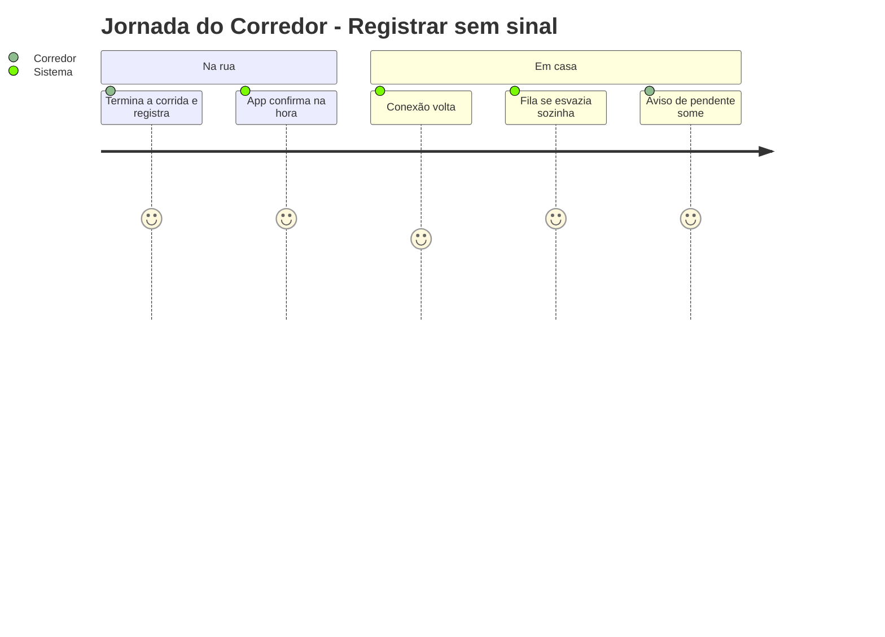
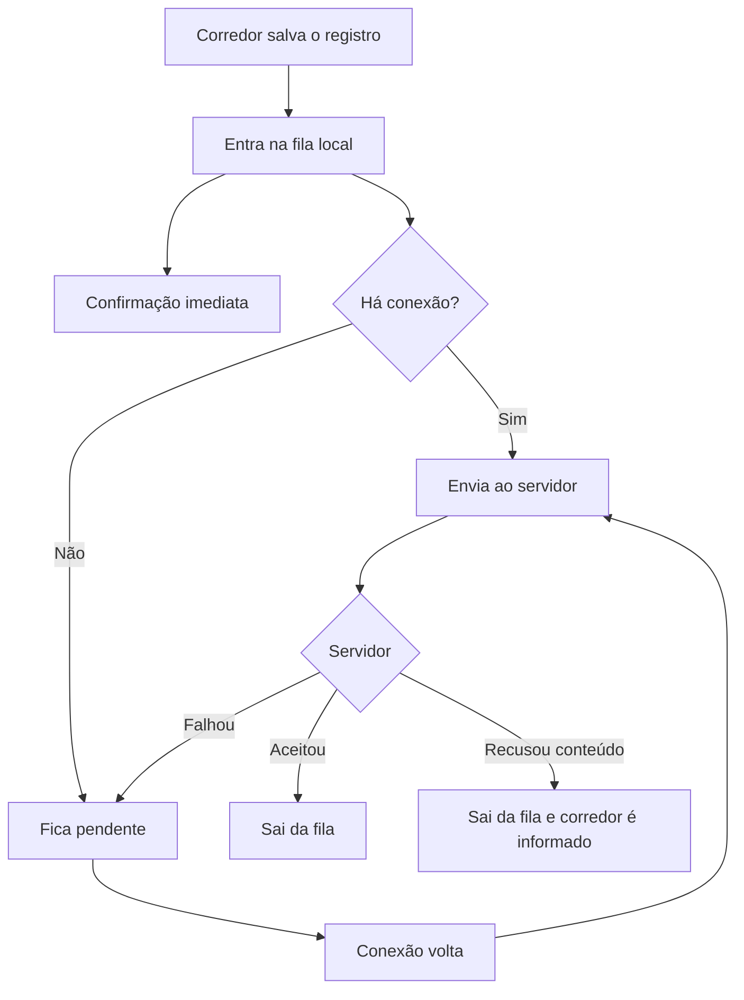

# Registro Offline - Fila Offline - Regras de Negócio

## Índice

- [1. Resumo da Funcionalidade](#1-resumo-da-funcionalidade)
- [2. Jornada do Usuário](#2-jornada-do-usuário)
- [3. Regras de Negócio por Funcionalidade](#3-regras-de-negócio-por-funcionalidade)
- [4. Validações e Restrições](#4-validações-e-restrições)
- [5. Fluxos de Processo](#5-fluxos-de-processo)
- [6. Casos de Uso e Cenários](#6-casos-de-uso-e-cenários)

## 1. Resumo da Funcionalidade

**Propósito**: o corredor registra o treino logo depois de correr, muitas vezes na rua e sem sinal, e o registro nunca depende da conexão.
**Usuários**: corredores.
**Valor de Negócio**: sustenta a hipótese crítica de que o corredor registra de forma consistente (DISC-001) e mantém a avaliação de sobrecarga atualizada.
**Frequência de Uso**: a cada registro.
**Impacto Operacional**: define quando um registro está "guardado" e o que acontece com os que não chegam ao servidor.

## 2. Jornada do Usuário

### Pontos de Contato

- Telas de registro, que fecham ao salvar.
- Aviso na tela inicial: "N registro(s) pendente(s)".

## 3. Regras de Negócio por Funcionalidade

### 3.1. Guardar antes de enviar

**O que faz**: coloca o registro em uma fila local antes de qualquer chamada de rede.

**Regras Aplicadas**:

- **Guardado é guardado**: assim que entra na fila, o corredor recebe confirmação, com ou sem sinal.
- **Cada registro tem uma identidade própria** que não muda entre tentativas; por isso reenviar nunca duplica o treino no servidor.
- **Pendente e salvo são iguais para o corredor**: a diferença só aparece na contagem de pendentes da tela inicial.

### 3.2. Enviar quando possível

**Regras Aplicadas**:

- O envio é imediato quando há conexão; sem ela, o item espera.
- A fila se esvazia sozinha quando a conexão volta, sem o corredor reabrir ou registrar de novo.
- **Conteúdo recusado pelo servidor** sai da fila e o corredor é informado, porque reenviar nunca adiantaria.
- **Sessão perdida não perde registros**: o corredor vai ao login e a fila continua.

**Cenários de Uso**:

- **Principal**: com sinal, o registro sobe na hora.
- **Alternativo**: sem sinal, fica pendente e sobe depois.
- **Exceção**: o servidor recusa o conteúdo e o corredor vê o motivo.

**Resultado Esperado**: nenhum treino registrado se perde por falta de conexão.

## 4. Validações e Restrições

### Controle de Acesso

- A fila não guarda dono do registro; por isso é descartada na saída da conta (ADR-005).

### Dados e Entrada

- **Tipos de registro**: corrida, musculação, ficha de musculação, treino combinado, dor e pedido de plano.

### Restrições do Sistema

- **Dependências**: armazenamento local do aparelho.
- **Datas**: sempre no fuso local do aparelho, para o treino de uma noite não cair no dia seguinte.

## 5. Fluxos de Processo

## 6. Casos de Uso e Cenários

### Caso de Uso 1: Registrar sem sinal

**Ator Principal**: corredor
**Objetivo**: guardar a corrida feita na rua
**Pré-condições**: sem conexão

**Fluxo Principal**:

1. Preenche e salva o registro.
2. O app guarda e confirma; a tela fecha.
3. A tela inicial mostra "1 registro pendente".
4. Ao voltar a conexão, o item é enviado e o aviso some.

**Pós-condições**: registro único no servidor.

### Matriz de Cenários

| Cenário | Entrada | Ação do Sistema | Resultado Esperado |
| --- | --- | --- | --- |
| Registrar com conexão | Salvar treino | Guarda, envia, remove da fila | Confirmado e sem pendente |
| Registrar sem conexão | Salvar treino offline | Guarda e mantém na fila | Confirmado, "1 registro pendente" |
| Conexão volta | Reconexão | Envia a fila | Aviso de pendente some |
| Reenvio do mesmo item | Falha após o servidor gravar | Reenvia com a mesma identidade | Sem duplicata |
| Conteúdo recusado | 400 do servidor | Remove da fila e informa | Corredor vê a mensagem |
| Sessão perdida ao registrar | 401 sem renovação | Mantém a fila e vai ao login | Registro volta a subir após novo login |
| Registro de outro tipo recusado durante o envio | Item antigo recusado | Remove da fila | Ver débitos: o corredor pode não ser avisado |
