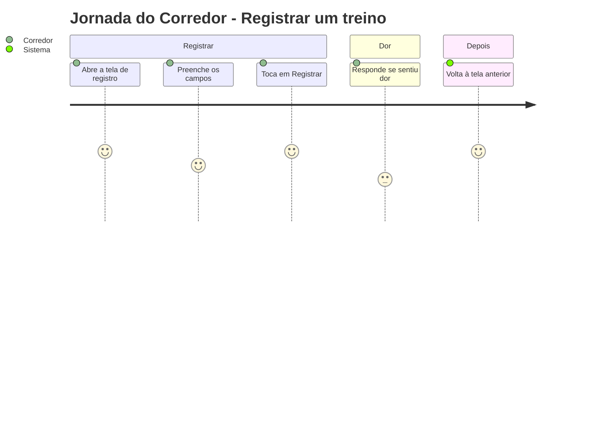
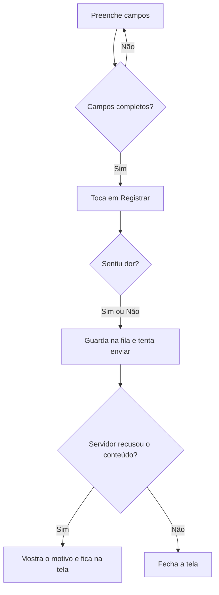

# Registro de Treino - Registro - Regras de Negócio

## Índice

- [1. Resumo da Funcionalidade](#1-resumo-da-funcionalidade)
- [2. Jornada do Usuário](#2-jornada-do-usuário)
- [3. Regras de Negócio por Funcionalidade](#3-regras-de-negócio-por-funcionalidade)
- [4. Validações e Restrições](#4-validações-e-restrições)
- [5. Fluxos de Processo](#5-fluxos-de-processo)
- [6. Casos de Uso e Cenários](#6-casos-de-uso-e-cenários)

## 1. Resumo da Funcionalidade

**Propósito**: o corredor registra corridas, musculações e dores para alimentar o histórico e a avaliação de sobrecarga.
**Usuários**: corredores.
**Valor de Negócio**: dados que sustentam o aviso de risco de sobrecarga e a revisão de aderência.
**Frequência de Uso**: a cada treino realizado.
**Impacto Operacional**: o registro é da data de hoje; correções geram novos registros, nunca edição (Lei do Domínio #2).

## 2. Jornada do Usuário

### Pontos de Contato

- Três telas: **Registrar corrida**, **Registrar musculação**, **Registrar dor**.
- Aviso "Hoje no seu plano" quando a tela abre pelo detalhamento do dia.
- Diálogo "Sentiu dor neste treino?".

## 3. Regras de Negócio por Funcionalidade

### 3.1. Registrar corrida

**O que faz**: guarda distância, duração, ritmo médio e esforço percebido de 1 a 10.

**Regras Aplicadas**:

- Todos os quatro campos são necessários para habilitar o botão.
- **O plano não preenche os números**: eles são o que aconteceu, não o que estava previsto.
- Distância e ritmo aceitam vírgula.
- Quem decide se os valores são aceitáveis é o servidor; a mensagem de recusa vem de lá.

### 3.2. Registrar musculação

**Regras Aplicadas**:

- Grupo muscular, intensidade e duração são obrigatórios.
- Quando a tela abre pelo plano, o grupo do dia vem sugerido, mas o corredor pode trocar.
- Treino de perna pesado é o que a avaliação cruza com o volume de corrida.

### 3.3. Dor no encerramento

**Regras Aplicadas**:

- **Responder é obrigatório** para concluir corrida ou musculação.
- "Sim" é informação que o servidor usa para priorizar recuperação na revisão.
- Fechar o diálogo sem responder não salva.

### 3.4. Registrar dor avulsa

**Regras Aplicadas**:

- A dor é independente do treino: costuma surgir horas ou dias depois.
- Regiões comuns ou texto livre; o texto livre vence a escolha.

### 3.5. Corrida de um dia combinado

**Regras Aplicadas**:

- Musculação e corrida do mesmo dia são enviadas como **um único registro** (ADR-011).
- Se o corredor sair sem registrar a corrida, a musculação é guardada sozinha.

**Resultado Esperado**: o registro fica guardado (pendente ou enviado) e a tela fecha.

## 4. Validações e Restrições

### Controle de Acesso

- Sessão ativa; sem ela o corredor vai ao login com a fila preservada.

### Dados e Entrada

- **Dados Obrigatórios**: todos os campos de cada tela.
- **Formatos Aceitos**: números com vírgula ou ponto.
- **Data**: sempre hoje, no fuso do aparelho; não há registro retroativo.

### Restrições do Sistema

- **Dependências**: nenhuma conexão para guardar (fila offline).

## 5. Fluxos de Processo

## 6. Casos de Uso e Cenários

### Caso de Uso 1: Registrar corrida do dia

**Ator Principal**: corredor
**Objetivo**: guardar a corrida feita hoje
**Pré-condições**: sessão ativa

**Fluxo Principal**:

1. Abre "Registrar corrida" e preenche distância, duração, ritmo e esforço.
2. Toca em "Registrar corrida" e responde sobre dor.
3. O app guarda e volta à tela anterior.

**Pós-condições**: registro na fila ou no servidor.

### Matriz de Cenários

| Cenário | Entrada | Ação do Sistema | Resultado Esperado |
| --- | --- | --- | --- |
| Registrar corrida completa | 4 campos e resposta sobre dor | Guarda e envia | Tela fecha |
| Campo faltando | 3 de 4 campos | Mantém botão desabilitado | Não registra |
| Dor respondida "Sim" | Resposta Sim | Envia `painReported` verdadeiro | Revisão prioriza recuperação |
| Fechar o diálogo de dor | Toque fora | Não salva | Continua na tela |
| Conteúdo recusado pelo servidor | Valor fora do aceitável | Mostra "Não foi salvo" com o motivo | Corredor corrige |
| Musculação pelo plano | Abre com o dia do plano | Sugere o grupo do dia | Corredor pode trocar |
| Dor com texto livre | "Outra região" preenchida | Usa o texto | Registra a região digitada |
| Sair do dia combinado sem corrida | Fecha a tela | Guarda só a musculação | Nenhuma perda |
| Registro sem conexão | Salvar offline | Guarda na fila | Tela fecha, aparece pendente |
