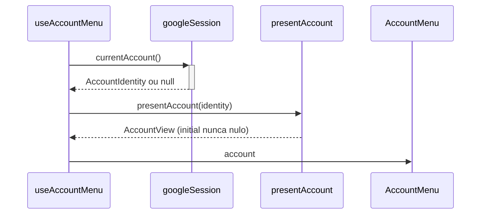
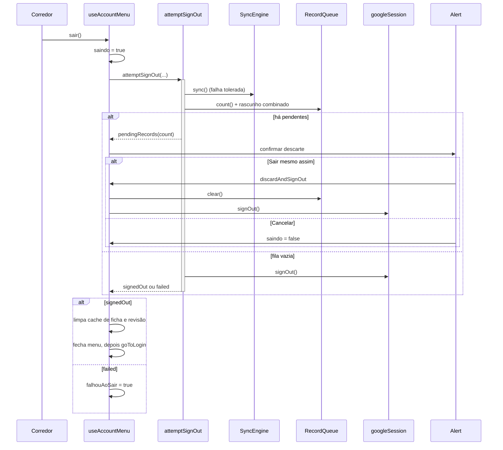

# AccountMenu - Conta - Especificação Técnica

## Índice

- [1. Visão Geral Técnica](#1-visão-geral-técnica)
- [2. Configuração e Dependências](#2-configuração-e-dependências)
- [3. Detalhamento por Fluxo](#3-detalhamento-por-fluxo)
  - [3.1. Identidade exibida no menu](#31-identidade-exibida-no-menu)
  - [3.2. Sair da conta](#32-sair-da-conta)
  - [3.3. Abrir e fechar o menu](#33-abrir-e-fechar-o-menu)
- [4. Observações Técnicas](#4-observações-técnicas)

## 1. Visão Geral Técnica

**Propósito**: menu lateral de perfil, com avatar, nome, e-mail e a saída da conta, reaproveitado pelas abas que oferecem o avatar (Dashboard e Planejamento).
**Responsabilidades**:

- `useAccountMenu`: estado do menu (aberto, identidade, "saindo", falha) e ligação com a regra de saída.
- `signOutAccount`: **regra** da saída (ADR-005), sem React.
- `signOutFeedback`: o que a tela faz com cada desfecho e o texto do aviso de descarte.
- `accountPresentation`: resolve identidade em `AccountView` (nome, e-mail, foto, inicial).
- `AccountMenu`, `AccountMenuDrawer`, `AccountMenuButton`: casca visual (drawer à esquerda, 78% da largura).

**Integrações**: `googleSession` (identidade e saída), `recordQueue`/`syncEngine` (fila), `combinedWorkoutDrafts` (rascunho combinado), caches de ficha e revisão.

## 2. Configuração e Dependências

**Dependências**:

- `react-native-drawer-layout` (`Drawer`) e `react-native-safe-area-context`.
- `../services`: `combinedWorkoutDrafts`, `googleSession`, `recordQueue`, `syncEngine`, `trainingSheetCache`, `workoutReviewCache`.

**Superfície**:

- Hook `useAccountMenu()` -> `{ open, setOpen, account, saindo, falhouAoSair, sair }`.
- `attemptSignOut(queue, syncEngine, session, combinedDraft?) -> SignOutOutcome`.
- `discardAndSignOut(queue, session, combinedDraft?) -> SignOutOutcome`.
- `SignOutOutcome`: `signedOut` | `pendingRecords {count}` | `failed`.

## 3. Detalhamento por Fluxo

### 3.1. Identidade exibida no menu

**C. Hook (`useAccountMenu`)**

C.1. Efeito de identidade

- Lê `currentAccount()` uma vez na montagem; guarda em estado; um flag `ativo` evita atualizar depois de desmontar.
- Identidade é leitura volátil do módulo nativo, nunca persistida (ADR-002).

**P. `presentAccount`**

P.1. Normalização

- Texto em branco vira ausência (`textOrNull`); a inicial usa nome, depois e-mail, depois `?`.
- A inicial nunca é nula, porque o avatar é o gatilho do menu e precisa existir desde o primeiro frame, mesmo offline.

### 3.2. Sair da conta

#### Detalhamento do Fluxo

**H. Hook (`useAccountMenu`)**

H.1. `sair()`

- Ignora toque repetido enquanto `saindo`.
- Chama `attemptSignOut` [A.1](#a1-attemptsignout); `pendingRecords` devolve a decisão ao corredor [H.2](#h2-confirmardescarte); demais desfechos vão a `concluir`.

H.2. `confirmarDescarte(quantidade)`

- `Alert` com o número exato de registros (`pendingRecordsWarning`).
- "Cancelar" e fechar o diálogo (`onDismiss`) liberam `saindo`; "Sair mesmo assim" chama `discardAndSignOut`.

H.3. `concluir(outcome)`

- Em `signedOut`: `trainingSheetCache.clear()` e `workoutReviewCache.clear()` (sem aguardar).
- Aplica `applySignOutOutcome`: fecha o menu **antes** de navegar, para o painel não sobrar sobre o login.

**A. Regra (`signOutAccount`)**

A.1. `attemptSignOut`

- Sincroniza primeiro; com conexão a fila esvazia e o corredor não vê atrito.
- Soma `queue.count()` e +1 se há rascunho combinado pendente.
- Sem pendentes, `endSession`.

A.2. `discardAndSignOut`

- Descarta fila e rascunho **antes** de encerrar a sessão (ADR-005): falhar com a fila limpa e a sessão ativa é ruim, mas seguro; o contrário deixaria fila órfã exposta ao próximo corredor.

A.3. `endSession`

- `session.signOut()` verdadeiro vira `signedOut`; falso vira `failed`.

### 3.3. Abrir e fechar o menu

- O avatar (`AccountMenuButton`) chama `setOpen(true)`; o `Drawer` também abre por gesto.
- Com o menu aberto, o botão voltar do Android é consumido (`BackHandler`) e só fecha o menu.

## 4. Observações Técnicas

- **Performance**: leitura de identidade síncrona na biblioteca nativa; nenhum acesso a rede no menu.
- **Tratamento de Erros**: falha ao sair mostra "Não foi possível sair. Você continua conectado."; o corredor continua autenticado.
- **Integrações Críticas**: a ordem fila-antes-da-sessão do ADR-005.
- **Segurança**: a saída só encerra a sessão neste aparelho; a limpeza de caches na saída cobre ficha e revisão, mas não plano nem rascunho (ver débitos).
