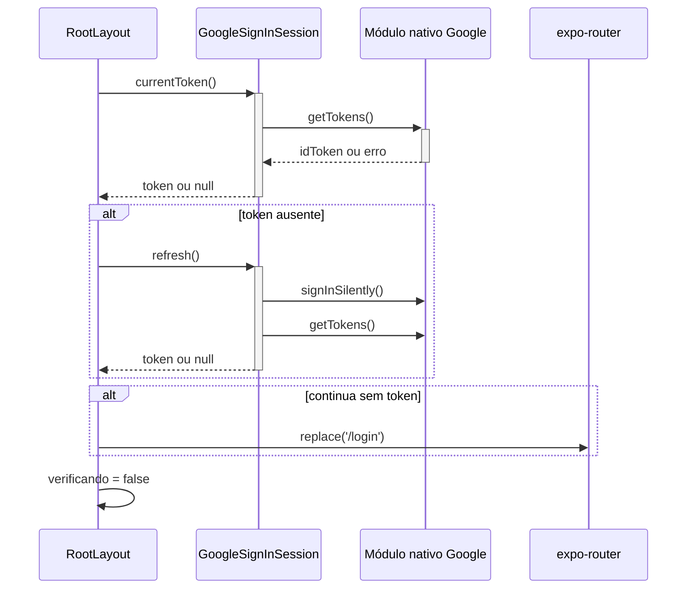
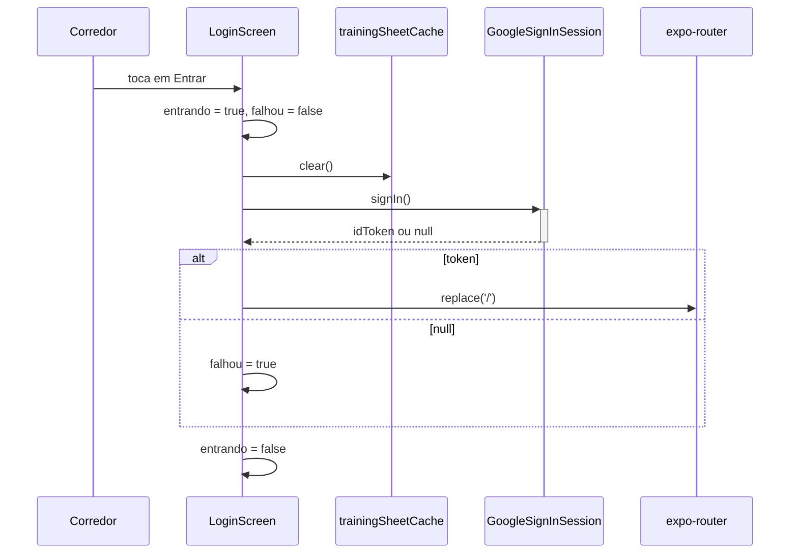

# AuthSession - Autenticação - Especificação Técnica

## Índice

- [1. Visão Geral Técnica](#1-visão-geral-técnica)
- [2. Configuração e Dependências](#2-configuração-e-dependências)
- [3. Detalhamento por Fluxo](#3-detalhamento-por-fluxo)
  - [3.1. Verificação de sessão na abertura](#31-verificação-de-sessão-na-abertura)
  - [3.2. Login interativo](#32-login-interativo)
  - [3.3. Obtenção e renovação do token](#33-obtenção-e-renovação-do-token)
  - [3.4. Ida ao login sem tela autenticada na pilha](#34-ida-ao-login-sem-tela-autenticada-na-pilha)
  - [3.5. Composition root](#35-composition-root)
- [4. Observações Técnicas](#4-observações-técnicas)

## 1. Visão Geral Técnica

**Propósito**: autenticar o corredor com o Google, manter o ID token que o backend valida a cada requisição e decidir, na abertura do app, entre mostrar o login ou seguir para as abas.

**Responsabilidades**:

- `app/_layout.tsx`: raiz de navegação; tenta reaproveitar a sessão antes de desenhar qualquer tela.
- `app/login.tsx`: única tela de entrada, só com Google (a Constituição proíbe senha própria).
- `src/auth/googleSession.ts`: contratos `TokenSource` (token + renovação) e `GoogleSession` (login, saída, conta atual).
- `src/auth/googleSignInSession.ts`: implementação sobre a porta `GoogleSignInClient`; toda ausência de sessão vira `null`, nunca exceção.
- `src/auth/nativeGoogleSignInClient.ts`: único arquivo que toca `@react-native-google-signin/google-signin`.
- `src/auth/goToLogin.ts`: navegação ao login esvaziando a pilha.
- `src/services.ts`: composition root, onde todas as peças são instanciadas uma única vez.

**Integrações**: Google Sign-In nativo (só em *development build*; Expo Go não funciona) e, indiretamente, a API, que valida o `idToken` com audiência igual ao `Google:ClientId` (ADR-002).

## 2. Configuração e Dependências

**Variáveis de ambiente (embutidas no bundle em tempo de build)**:

- `EXPO_PUBLIC_GOOGLE_WEB_CLIENT_ID`: Client ID do tipo Web. Precisa ser idêntico ao `Google:ClientId` da API; se divergir, todo login vira 401. Vazio faz `isGoogleConfigured = false` e a tela de login avisa em vez de falhar em silêncio.
- `EXPO_PUBLIC_API_URL`: base da API (padrão `http://localhost:5050`, que no celular aponta para o próprio aparelho).

**Contratos**:

- `TokenSource { currentToken(), refresh() }`: o que os clientes HTTP recebem. Separado de `GoogleSession` para que eles não ganhem o poder de encerrar a sessão.
- `GoogleSession extends TokenSource { signIn(), signOut(): boolean, currentAccount() }`.
- `GoogleSignInClient`: porta com `signIn`, `signInSilently`, `getTokens`, `currentUser`, `signOut`; permite testar sem módulo nativo.

**Telas e fluxos**:

- **Rota** `/login`: tela de login (sem cabeçalho).
- **Rota** `/(tabs)` e demais: só alcançáveis após `_layout` confirmar token.

## 3. Detalhamento por Fluxo

### 3.1. Verificação de sessão na abertura

**Gatilho**: montagem de `RootLayout`.
**Saída**: tela de carregamento enquanto verifica; depois `Stack` ou redirecionamento a `/login`.

#### Fluxo de Execução

#### Detalhamento do Fluxo

**C. Tela (`app/_layout.tsx`)**

C.1. `useEffect` de sessão

- Chama `googleSession.currentToken()`; se `null`, chama `googleSession.refresh()` (renovação silenciosa) [S.2](#s2-refresh).
- Se ainda não há token, `router.replace('/login')`.
- Um flag `ativo` evita atualizar estado depois de desmontar.
- **Não valida o token**: só testa se existe. A validade é testada no primeiro request autenticado.

C.2. `useEffect` de sincronização

- `combinedWorkoutDrafts.recover()` seguido de `syncEngine.sync()`; erros engolidos.
- `startAutoSync(netInfoConnectivity, syncEngine)` observa a conectividade; o retorno cancela a observação.

**S. Sessão (`GoogleSignInSession`)**

S.1. `currentToken()`

- Compartilha uma leitura em andamento (`leituraEmAndamento`) entre chamadores concorrentes: duas chamadas simultâneas a `getTokens()` no módulo nativo podem falhar na segunda, e o `null` seria lido como sessão perdida.

S.2. `refresh()`

- Compartilha a renovação em andamento (`renovacaoEmAndamento`) pelo mesmo motivo; ao terminar, o resultado não fica em cache.
- `signInSilently()` e, se deu certo, `getTokens()`.

### 3.2. Login interativo

**Gatilho**: toque em "Entrar com o Google".

**C. Tela (`app/login.tsx`)**

C.1. `entrar()`

- Limpa o cache da ficha antes do login, porque o login pode trocar de conta Google e a ficha anterior não pode atravessar a troca.
- Chama `googleSession.signIn()`; em sucesso `router.replace('/')`, senão exibe "Não foi possível entrar".
- O botão fica desabilitado se `entrando` ou `!isGoogleConfigured`.
- **Só `trainingSheetCache` é limpo aqui.** Os caches da revisão (`workoutReviewCache`) e do plano (`steadyTrainingPlanCache`) não são tocados; ver [débitos](../debts/AuthSession-Autenticacao-Debts.md).

### 3.3. Obtenção e renovação do token

Quem consome token (`HttpRecordApi`, `HttpQueryApi`, `HttpCoachingApi`) repete a mesma política: `currentToken() ?? refresh()`; no primeiro 401, `refresh()` uma única vez e repete; segundo 401 vira `unauthenticated`. Ver [HttpClients](HttpClients-Integracao-DevDocs.md).

### 3.4. Ida ao login sem tela autenticada na pilha

**C. `goToLogin(router)`**

- Se `router.canDismiss()`, `dismissAll()` antes de `replace('/login')`.
- Sem isso, o gesto de voltar reexibiria a home já sem sessão.
- Usado por `useRecordLogger` (`sessionLost`) e por `useAccountMenu` (saída concluída).

### 3.5. Composition root

`src/services.ts` instancia, nesta ordem: `googleSession`, `recordQueue` (gerador de chave via `Crypto.randomUUID()`), `recordApi`, `syncEngine`, `queryApi`, `coachingApi`, `workoutReviewCache`, `trainingSheetCache`, `steadyTrainingPlanCache`, `combinedWorkoutDrafts`. Todos os clientes HTTP recebem `fetch` e `googleSession` como `TokenSource`.

`configureAuth()` só chama `GoogleSignin.configure({ webClientId })` se o Client ID existe; é executado no escopo do módulo de `_layout.tsx`, antes do primeiro render.

## 4. Observações Técnicas

- **Performance**: nenhuma chamada de rede na abertura além do módulo nativo; o app só mostra um `ActivityIndicator` enquanto verifica.
- **Tratamento de Erros**: toda falha do módulo nativo vira `null` (`attempt` e `tokenOrNull`); `signOut` devolve `false` em vez de lançar, e o app não anuncia "você saiu" quando o encerramento falha (ADR-005).
- **Integrações Críticas**: o `webClientId` do app e o `Google:ClientId` da API precisam coincidir (ADR-002).
- **Segurança**: sem senha própria; o ID token é lido do módulo nativo a cada uso e não é persistido pelo app. A identidade exibida (`currentAccount`) é leitura volátil. A troca de conta no login exige limpeza completa dos caches locais (ver débitos).
