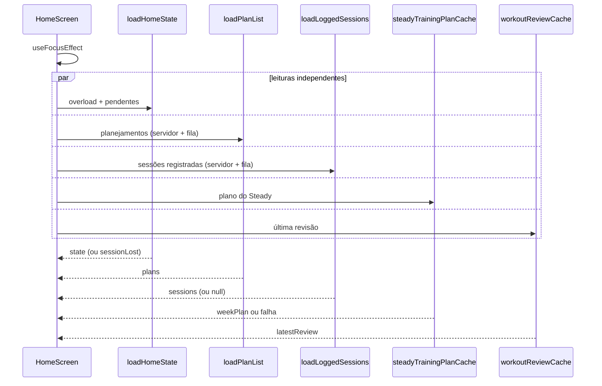

# HomeDashboard - Dashboard - Especificação Técnica

## Índice

- [1. Visão Geral Técnica](#1-visão-geral-técnica)
- [2. Configuração e Dependências](#2-configuração-e-dependências)
- [3. Detalhamento por Fluxo](#3-detalhamento-por-fluxo)
  - [3.1. Carga da tela a cada foco](#31-carga-da-tela-a-cada-foco)
  - [3.2. Cabeçalho, saudação e contagem](#32-cabeçalho-saudação-e-contagem)
  - [3.3. Avanço do plano](#33-avanço-do-plano)
  - [3.4. Revisão do treino](#34-revisão-do-treino)
  - [3.5. Abas e área do personal](#35-abas-e-área-do-personal)
- [4. Observações Técnicas](#4-observações-técnicas)

## 1. Visão Geral Técnica

**Propósito**: tela inicial (aba Dashboard). Mostra a avaliação de sobrecarga, a última revisão de treino, o treino do dia, o avanço do plano, a pendência de sincronização e os atalhos de registro.
**Responsabilidades**: orquestrar leituras independentes e tolerantes a falha; decidir o destino de "Ver plano da semana"; hospedar o menu da conta.
**Integrações**: `queryApi`, `coachingApi`, `recordQueue`, `steadyTrainingPlanCache`, `workoutReviewCache`, AsyncStorage (aviso de conflito já visto).

## 2. Configuração e Dependências

**Telas (rotas)**: `/(tabs)/index` (aba Dashboard), `/(tabs)/_layout` (barra de abas), destinos `/log/run`, `/log/strength`, `/log/pain`, `/history`, `/planning/plan`, `/planning/new`.

**Módulos de apoio** (`src/home`):

- `homeState.loadHomeState(queue, api)` -> `{ overload, pendingCount, sessionLost }`.
- `homeHeader(now, displayName, plans)` -> `{ greeting, line, tag }`.
- `greeting(hour, displayName)`: primeiro nome; 5 h a 12 h "Bom dia", 12 h a 18 h "Boa tarde", resto "Boa noite".
- `planProgressView(progress)`: `hidden | unavailable | ok` com percentual e nota.

## 3. Detalhamento por Fluxo

### 3.1. Carga da tela a cada foco

#### Detalhamento do Fluxo

**C. Tela (`HomeScreen`)**

C.1. `useFocusEffect`

- Recarrega a cada foco, para refletir o treino que acabou de sincronizar.
- Cinco leituras disparadas em paralelo, cada uma com o flag `active`.
- `sessionLost` de qualquer uma leva a `goToLogin(router)`.
- `loadPlanList` e `loadLoggedSessions` toleram falha: o avanço some, o resto da tela fica.
- `loadLoggedSessions` devolve `null` em "não consegui ler"; nunca vira 0% (ADR-004).

C.2. Destino de "Ver plano da semana"

- Com planejamento: `/planning/plan?key={idempotencyKey}&section=semana&day={weekPlanIndexFor(hoje)}`.
- Sem planejamento: `/planning/new`.

**L. `loadLoggedSessions`** (módulo de planejamento)

L.1. Junta o histórico do servidor com a fila local; `running`, `strength`, `strengthWorkout` e `combinedWorkout` contam; `plan` e `pain` não cumprem dia. Sem deduplicar: o estado do dia é binário por modalidade.

### 3.2. Cabeçalho, saudação e contagem

- `homeHeader` usa `trainingProgress(now, raceDate do plano mais recente)`:
  - `noPlan` -> convite "Crie seu planejamento para ver sua semana".
  - `beforeStart` -> "O plano começa em N semanas" + etiqueta de semanas até a prova.
  - `inPlan` -> "Semana X de Y · fase Z" + etiqueta.
  - `raceDay` -> etiqueta "É hoje".
  - `raceOver` -> sem linha nem etiqueta.
- A saudação nunca usa o e-mail.

### 3.3. Avanço do plano

- `planProgress(now, latestPlan, sessions, weekPlan)` -> `planProgressView`: `none` esconde; `unavailable` mostra "Não foi possível ler seus registros agora."; `ok` mostra percentual e "X de Y treinos do plano".
- A nota "Você entrou na semana N" evita que um corredor que entrou tarde veja um percentual baixo como fracasso.

### 3.4. Revisão do treino

**`WorkoutReviewCard`**

- Exibe título, ação recomendada, linhas de comparação, explicação (ou aviso de indisponibilidade com "Tentar novamente") e coerência.
- Botões: "Entendi" (`POST /understood`), "Tentar novamente" (`POST /retry`), "Isso não faz sentido" (`POST /contest`).
- Após qualquer comando `ok`, relê a última revisão e atualiza o cartão.
- Conflito de prescrições (`isConflict`): `Alert` "Prescrições em conflito" uma única vez por revisão; o "visto" fica em `AsyncStorage` na chave `steady.review-conflict-seen.{id}`. Fechar o alerta não resolve o conflito.

### 3.5. Abas e área do personal

**`app/(tabs)/_layout.tsx`**

- Abas: Dashboard, Planejamento e Personal.
- A aba Personal só aparece quando `coachingApi.account()` devolve `ok` com role de personal (`hasPersonalArea`); falha da consulta mantém a aba escondida. A autorização real é do servidor.

## 4. Observações Técnicas

- **Performance**: cinco requisições a cada foco da tela, mais a lista de abas (`account`) na montagem.
- **Tratamento de Erros**: cada leitura falha isoladamente; nenhuma falha vira estado "vazio" enganoso.
- **Integrações Críticas**: o app **nunca calcula** risco; exibe o `OverloadView` do servidor (FF-004).
- **Segurança**: a revisão em cache pode aparecer como `stale`; o isolamento entre contas depende da limpeza na troca (ver débitos de [AuthSession](../debts/AuthSession-Autenticacao-Debts.md)).
