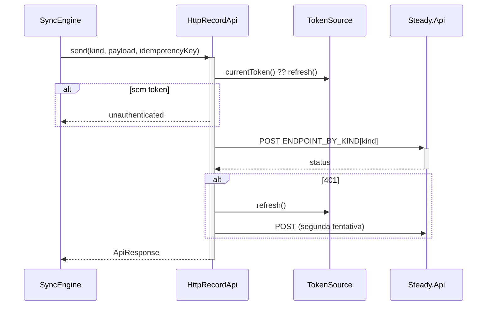

# HttpClients - Integração - Especificação Técnica

## Índice

- [1. Visão Geral Técnica](#1-visão-geral-técnica)
- [2. Configuração e Dependências](#2-configuração-e-dependências)
- [3. Detalhamento por Fluxo](#3-detalhamento-por-fluxo)
  - [3.1. Envio de registro (`HttpRecordApi`)](#31-envio-de-registro-httprecordapi)
  - [3.2. Leitura (`HttpQueryApi`)](#32-leitura-httpqueryapi)
  - [3.3. Coaching, plano e revisão (`HttpCoachingApi`)](#33-coaching-plano-e-revisão-httpcoachingapi)
- [4. Observações Técnicas](#4-observações-técnicas)

## 1. Visão Geral Técnica

**Propósito**: única fronteira do app com a API Steady. Três clientes, cada um com um vocabulário de resultado adequado ao seu uso.
**Responsabilidades**:

- Anexar o ID token do Google (`Authorization: Bearer`).
- Renovar o token uma vez no primeiro 401 e repetir a chamada.
- Traduzir status HTTP para resultados que a camada de cima entende (fila, tela ou cache).

**Integrações**: `Steady.Api` (`/api/*`) e a sessão Google via `TokenSource`.

## 2. Configuração e Dependências

**Dependências injetadas** (todos recebem `baseUrl`, `TokenSource` e um `fetch` mínimo):

- `HttpRecordApi implements RecordApi`: usado pelo `SyncEngine`.
- `HttpQueryApi implements QueryApi, PlanRequestReader`: sobrecarga, histórico, pedidos de plano.
- `HttpCoachingApi implements CoachingApi, SteadyTrainingPlanReader`: conta, vínculos, ficha, revisão, plano do Steady.

**Mapa de endpoints consumidos**:

| Cliente | Método | Rota |
| --- | --- | --- |
| `HttpRecordApi` | POST | `/api/running-sessions`, `/api/strength-sessions`, `/api/coaching/strength-executions`, `/api/coaching/combined-executions`, `/api/pain-logs`, `/api/plan-requests` (cabeçalho `Idempotency-Key`) |
| `HttpQueryApi` | GET | `/api/overload-assessment`, `/api/training-sessions`, `/api/plan-requests` |
| `HttpCoachingApi` | GET | `/api/account`, `/api/coaching/training-sheet/active`, `/api/coaching/links/pending`, `/api/coaching/link/active`, `/api/coaching/runners`, `/api/coaching/runners/{id}/history`, `/api/coaching/runners/search?email=`, `/api/workout-reviews/latest`, `/api/workout-reviews/by-execution/{id}`, `/api/planning/steady-plan` |
| `HttpCoachingApi` | POST/DELETE | `/api/coaching/links`, `.../links/{id}/accept`, `DELETE .../links/{id}`, `.../runners/{id}/training-sheets`, `/api/workout-reviews/{id}/understood`, `/retry`, `/contest` |

## 3. Detalhamento por Fluxo

### 3.1. Envio de registro (`HttpRecordApi`)

**Tradução de status** (`translate`):

| HTTP | `ApiResponse` | Destino na fila |
| --- | --- | --- |
| 200, 201 | `ok` | removido |
| 400 | `rejected { message }` (campo `error` do corpo) | removido |
| 401 | `unauthenticated` | fila intacta, ciclo para |
| demais | `serverFailure` | permanece |
| exceção do `fetch` | `transportFailure` | permanece |

A `Idempotency-Key` vai em todas as tentativas do mesmo item (ADR-003).

### 3.2. Leitura (`HttpQueryApi`)

- Mesma política de token e de um único retry após 401.
- `200` -> `ok` com tradução defensiva (`toOverloadView`, `toSessions`, `toPlanRequests`; tudo que vem da rede é `unknown` até provar o contrário).
- `401` -> `unauthenticated`; qualquer outro status ou exceção -> `failure`.
- `toOverloadView`: sem `hasSufficientHistory === true` retorna `gatheringData` (precede qualquer outra decisão, ADR-004); `risk` exige `hasRisk` e sugestão não vazia.
- O app **nunca calcula** risco (FF-004): só exibe o que o servidor devolve.

### 3.3. Coaching, plano e revisão (`HttpCoachingApi`)

- `get<T>`: `200` -> `ok` com o JSON **sem validação** (`as T`; é a API do próprio Steady); `401` -> `unauthenticated`; resto -> `failure`.
- `command<T>`: `200/201/204` -> `ok` (corpo opcional); `401`; `404` -> `notFound`; `409` -> `conflict`; `400` e `403` -> `rejected`; resto -> `failure`. A mensagem vem do campo `error`, com texto padrão se o corpo for ilegível.
- `authorized`: envolve tudo em `try/catch`; falha de rede vira status `0` e, portanto, `failure`.

## 4. Observações Técnicas

- **Performance**: sem cache, sem timeout explícito nem cancelamento; depende do padrão do `fetch` do React Native.
- **Tratamento de Erros**: a distinção `rejected` (permanente) versus transitório é o que impede a fila de reenviar para sempre um corpo recusado.
- **Integrações Críticas**: o contrato do corpo de erro `{ "error": "..." }` da API.
- **Segurança**: o token só trafega em `Authorization`; nenhum cliente persiste token. A política de token está repetida nos três clientes.
