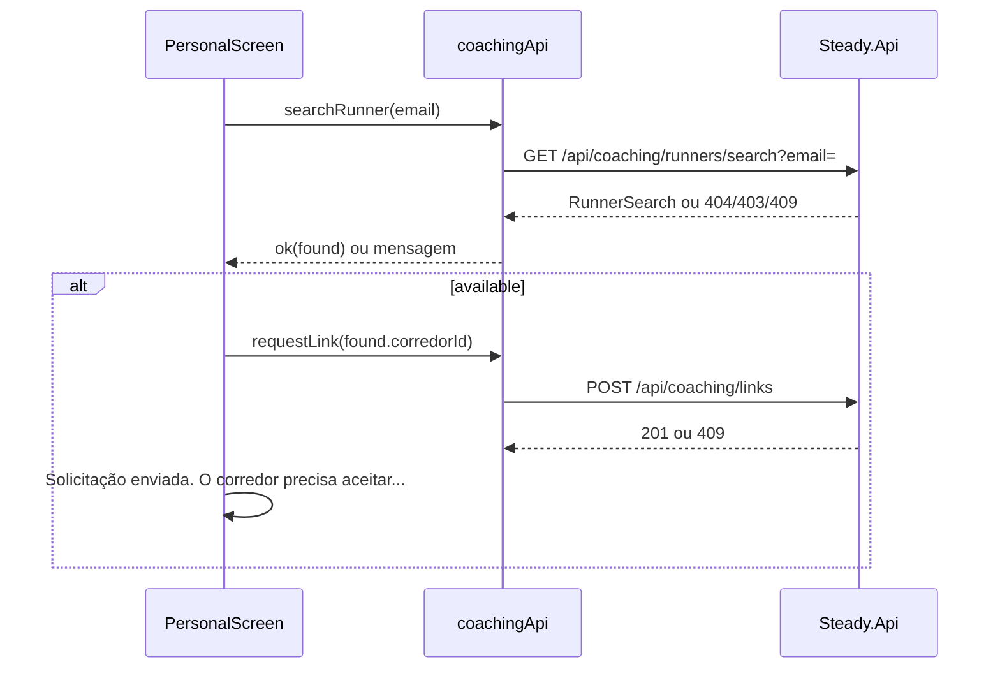
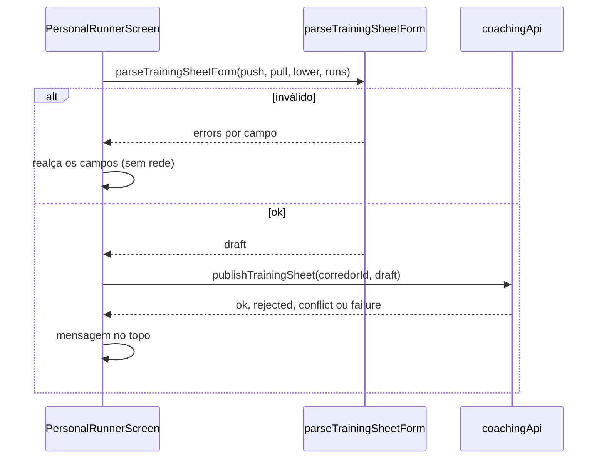

# PersonalCoach - Personal - Especificação Técnica

## Índice

- [1. Visão Geral Técnica](#1-visão-geral-técnica)
- [2. Configuração e Dependências](#2-configuração-e-dependências)
- [3. Detalhamento por Fluxo](#3-detalhamento-por-fluxo)
  - [3.1. Buscar corredor e solicitar vínculo](#31-buscar-corredor-e-solicitar-vínculo)
  - [3.2. Lista de corredores vinculados](#32-lista-de-corredores-vinculados)
  - [3.3. Publicar a ficha](#33-publicar-a-ficha)
  - [3.4. Histórico do corredor](#34-histórico-do-corredor)
- [4. Observações Técnicas](#4-observações-técnicas)

## 1. Visão Geral Técnica

**Propósito**: área do personal: encontrar corredores pelo e-mail, solicitar vínculo, publicar a ficha de treino e acompanhar o histórico e as revisões de quem aceitou.
**Responsabilidades**:

- `app/(tabs)/personal.tsx`: aba (busca, solicitação, lista de vinculados).
- `app/personal/runner.tsx`: ficha e histórico de um corredor.
- `trainingSheetSchema` (zod): validação **estrutural** do formulário, com erro por campo.
- `trainingSheetFormState`: operações puras de remover exercício e limpar erro.
- `coachingTimeline` e `runnerLabel`: apresentação do histórico e do nome do corredor.
**Integrações**: `GET /api/coaching/runners`, `GET /api/coaching/runners/search`, `POST /api/coaching/links`, `GET /api/coaching/runners/{id}/history`, `POST /api/coaching/runners/{id}/training-sheets`, `DELETE /api/coaching/links/{id}`.

## 2. Configuração e Dependências

**Telas**: `/(tabs)/personal` ("Área do personal"; a aba só aparece com a role Personal) e `/personal/runner?linkId&corredorId&email&name` (título "Corredor").

**Contratos** (`types.ts`): `RunnerSearch { corredorId, email, available, name }`, `LinkedRunner { linkId, corredorId, email, name }`, `TrainingSheetDraft { push[], pull[], lower[], tuesdayRun, thursdayRun, saturdayRun }`, `CoachingHistory { strengthExecutions[], runningSessions[], reviews? }`.

## 3. Detalhamento por Fluxo

### 3.1. Buscar corredor e solicitar vínculo

- O e-mail só **localiza** o candidato; a autorização nasce do vínculo ativo (ADR-008).
- Mensagens: não encontrado, já tem vínculo ativo (`available = false`), mensagem do servidor em conflito ou rejeição, texto genérico em falha.
- `runnerLabel`: nome do Google ou, na falta, o e-mail.

### 3.2. Lista de corredores vinculados

- `linkedRunners()` a cada foco; cada cartão abre `/personal/runner` com `linkId`, `corredorId`, `email` e `name` (nulo vira texto vazio, pois `null` viraria a string "null" no parâmetro de rota).

### 3.3. Publicar a ficha

**Z. Schema (`trainingSheetSchema.ts`)**

Z.1. Exercício: nome obrigatório; séries e repetições obrigatórias e **inteiras**; tempo (segundos) opcional e inteiro; observação opcional com até 200 caracteres.
Z.2. Corrida (terça, quinta, sábado): descrição obrigatória; distância opcional como **valor único** com vírgula ou ponto; duração e esforço opcionais em faixa (mínimo e máximo inteiros); máximo exige mínimo e deve ser maior.
Z.3. Em branco é ausência (`null`), nunca zero nem texto vazio (ADR-012).
Z.4. Os **limites de domínio** (séries 1 a 20, repetições 1 a 100, esforço 1 a 10) ficam só no backend; recusa do servidor aparece no topo.
Z.5. Cada erro é endereçado por caminho (`push.0.sets`, `tuesdayRun.durationMax`); a primeira mensagem de cada campo vence.

**R. Tela**

R.1. Os formulários só aparecem após "Criar Ficha" (a tela não abre pedindo 15 campos).
R.2. Cada seção (`ExerciseSection`) tem cartões de exercício com remoção; `canRemoveExercise` impede esvaziar o treino (mínimo 1); `dropExerciseErrors` reindexa os erros ao remover; `clearFieldError` apaga só o erro do campo corrigido.
R.3. Sucesso: "Ficha publicada e ativa. As cargas começam vazias para o corredor."

### 3.4. Histórico do corredor

- `coachingApi.history(corredorId)` na montagem; `unauthenticated` vai ao login.
- `coachingTimeline`: junta musculações e corridas e ordena por data decrescente (ISO compara por texto), para o treino de hoje aparecer no topo.
- Musculação mostra tipo, data e cada exercício com séries x repetições, carga ou "Não realizado" e a nota do corredor; corrida mostra distância, duração e esforço.
- `PersonalReview` mostra a revisão (título, ação, explicação, leitura confirmada, coerência) associada pelo `executionId`.
- "Encerrar vínculo" chama `endLink(linkId)` e volta.

## 4. Observações Técnicas

- **Performance**: uma leitura por tela; sem paginação do histórico.
- **Tratamento de Erros**: mensagens por status; falha ao publicar mantém o formulário preenchido.
- **Integrações Críticas**: a ficha nova substitui a ativa sem alterar histórico (ADR-009).
- **Segurança**: a aba é escondida por role no cliente, mas a autorização real (role e vínculo ativo) é do servidor; a busca por e-mail revela existência de conta (ADR-008 aceita para o MVP; limitar antes de produção pública).
