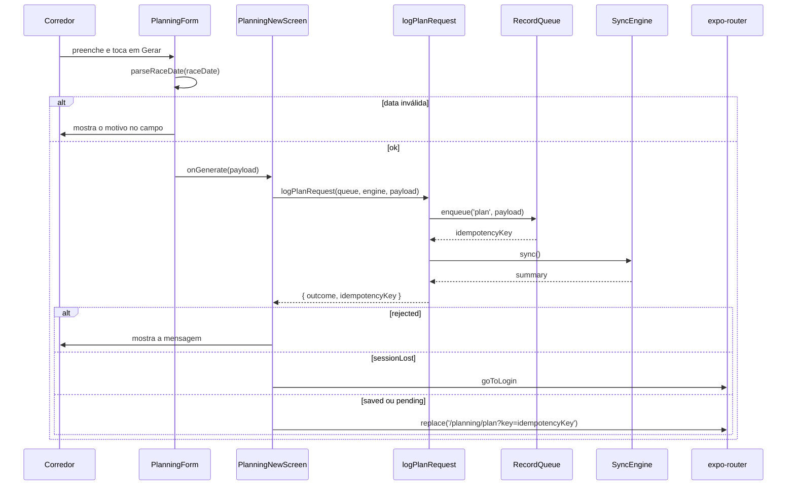

# PlanRequestForm - Planejamento - Especificação Técnica

## Índice

- [1. Visão Geral Técnica](#1-visão-geral-técnica)
- [2. Configuração e Dependências](#2-configuração-e-dependências)
- [3. Detalhamento por Fluxo](#3-detalhamento-por-fluxo)
  - [3.1. Criar planejamento](#31-criar-planejamento)
  - [3.2. Lista de planejamentos e vínculos](#32-lista-de-planejamentos-e-vínculos)
  - [3.3. Data da prova](#33-data-da-prova)
- [4. Observações Técnicas](#4-observações-técnicas)

## 1. Visão Geral Técnica

**Propósito**: coletar o pedido de plano do corredor (prova-alvo, base atual, disponibilidade, saúde), guardá-lo pela fila offline e listar os planejamentos do corredor, incluindo os ainda pendentes.
**Responsabilidades**:

- `PlanningForm`: formulário e conversão para `PlanRequestPayload`.
- `app/planning/new.tsx`: rota que enfileira e navega para o documento do plano.
- `app/(tabs)/planning.tsx`: aba Planejamento (lista, criação, vínculos com o personal).
- `planListState.loadPlanList`: junta servidor e fila.
- `raceDate`: máscara, validação e formatação da data da prova.
- `trainingPlanRequest`: vocabulário (distâncias, dias, equipamento, áreas de dor).

**Integrações**: `POST /api/plan-requests` (pela fila), `GET /api/plan-requests`, `GET/POST/DELETE /api/coaching/links*`.

## 2. Configuração e Dependências

**Telas (rotas)**: `/(tabs)/planning` (aba), `/planning/new` (título "Criar planejamento"), `/planning/plan` (destino, ver [PlanWeek](PlanWeek-Plano-DevDocs.md)).

**Contrato** (`PlanRequestPayload`): `raceDistance`, `raceDate` (ISO), `raceIsFirstTime`, `longestRecentRunKm`, `trainingDaysPerWeek`, `currentWeeklyRunningDays?`, `referenceDistanceKm?`, `referenceDuration?`, `strengthSessionMinutes?`, `equipmentAccess?`, `recurringPainAreas[]`, `priorInjuries?`.

**Tradução na API**: valores da tela (`"21.1"`, `"it_band"`, `"academia_completa"`) são convertidos para os enums do domínio em `PlanRequestContracts` (backend).

## 3. Detalhamento por Fluxo

### 3.1. Criar planejamento

#### Detalhamento do Fluxo

**C. Tela (`PlanningForm`)**

C.1. Habilitação

- Obrigatórios: distância, data, maior corrida recente e dias de treino por semana (`complete`).

C.2. `enviar()`

- Valida a data (único campo com formato) e normaliza para ISO **num ponto só** (ADR-007).
- `numero` troca vírgula por ponto; `numeroOuNulo` devolve `null` para campo vazio **e para texto não numérico**.
- Campos de referência (`referenceDistanceKm`, `referenceDuration`), força, equipamento e dias preferidos estão **comentados** no JSX; seus estados existem, mas ficam vazios e vão como `null`/`[]`.

**L. `logPlanRequest`**

L.1. Devolve a chave de idempotência junto do desfecho: o documento do plano abre pela chave mesmo se a rede estiver fora (STORY-010, regras 3 e 9).

### 3.2. Lista de planejamentos e vínculos

**C. Tela (`PlanningScreen`, aba)**

C.1. `useFocusEffect` carrega `loadPlanList(recordQueue, queryApi)` e `loadCoachingLinks()`; `sessionLost` vai ao login.

C.2. Estados: carregando, `unavailable` (aviso + "Nada guardado neste aparelho" se a fila está vazia), vazio ("Você ainda não criou nenhum planejamento") e lista. Cada cartão mostra `Pendente`, `Ativo` (o mais recente) ou `Anterior`, distância e data da prova.

C.3. Vínculos: `pendingLinks` mostra "Solicitação de vínculo" com "Aceitar vínculo" (`acceptLink`); `activeLink` mostra "Encerrar vínculo com o personal" (`endLink`). Mensagens: sucesso, conflito/rejeição com a mensagem do servidor, ou texto genérico.

**P. `loadPlanList`**

P.1. Converte itens `kind === 'plan'` da fila em `PlanRequestSummary` com `pending: true`.
P.2. Servidor vence na duplicidade (mesma chave): o item pode estar nos dois lados até o sync remover da fila.
P.3. Ordena por `createdAt` decrescente; `unauthenticated` -> `sessionLost`; falha -> `unavailable` com o que há na fila.

### 3.3. Data da prova

- `maskRaceDate`: o teclado numérico do Android não tem `/`; a máscara transforma `17052027` em `17/05/2027`.
- `parseRaceDate`: `invalidFormat`, `invalidDate` (ida e volta com `Date` denuncia 31/02), `notInFuture` (hoje ou antes), ou `ok` com ISO.
- `formatRaceDate`: ISO de volta para `dd/mm/aaaa`; devolve a entrada crua se não for ISO.

## 4. Observações Técnicas

- **Performance**: a aba faz 3 leituras por foco (planejamentos, vínculo pendente, vínculo ativo).
- **Tratamento de Erros**: falha de leitura nunca vira "você não tem planejamento" (ADR-004).
- **Integrações Críticas**: o nome `PlanRequestPayload` precisa acompanhar `PlanRequestContracts` do backend.
- **Segurança**: aceitar vínculo exige ação explícita do corredor; o aviso diz para aceitar só se reconhecer o personal (ADR-008).
- **Observação de produto**: o formulário não altera o plano gerado; o documento exibido é sempre o do Steady (DISC-002, ADR-013).
