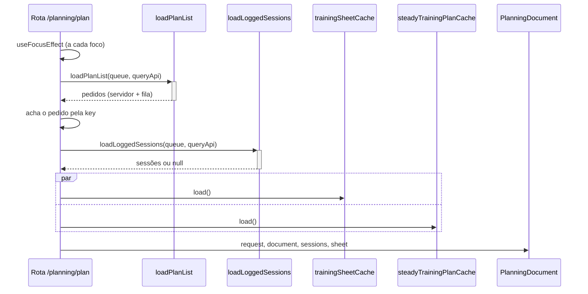
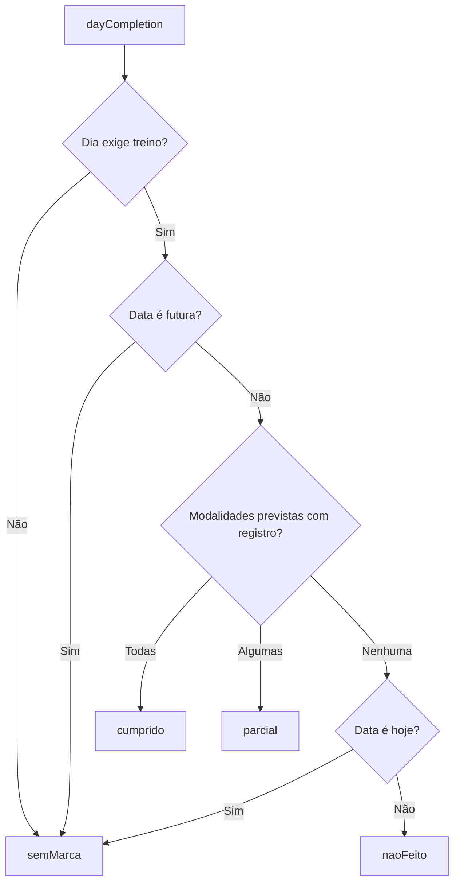

# PlanWeek - Plano - Especificação Técnica

## Índice

- [1. Visão Geral Técnica](#1-visão-geral-técnica)
- [2. Configuração e Dependências](#2-configuração-e-dependências)
- [3. Detalhamento por Fluxo](#3-detalhamento-por-fluxo)
  - [3.1. Abrir o documento do plano](#31-abrir-o-documento-do-plano)
  - [3.2. Seções do documento](#32-seções-do-documento)
  - [3.3. Estado de cada dia da semana](#33-estado-de-cada-dia-da-semana)
  - [3.4. Posição no plano e avanço](#34-posição-no-plano-e-avanço)
  - [3.5. Registrar o treino do dia](#35-registrar-o-treino-do-dia)
- [4. Observações Técnicas](#4-observações-técnicas)

## 1. Visão Geral Técnica

**Propósito**: exibir o plano do Steady de 24 semanas para um pedido de plano, com a semana detalhada dia a dia, o estado de cada dia (cumprido, parcial, não feito) e o caminho para registrar o treino de hoje.
**Responsabilidades**:

- `app/planning/plan.tsx`: carrega pedido, sessões registradas, ficha do personal e plano; decide dia e seção iniciais.
- `PlanningDocument`: quatro seções (Seus dados, Fases, Semana, Regras) com a Mobilidade integrada à Semana (STORY-020).
- `SemanaSection` / `DayRow`: estrutura semanal, lista de dias, botão "Registrar Treino" de hoje.
- Módulos puros de calendário e progresso: `trainingProgress`, `planWindow`, `dayRequirements`, `dayCompletion`, `weekStatuses`, `planProgress`, `registerAvailability`, `planDayParam`, `weekPlanDay`, `todaysTraining`, `plannedMuscleGroup`.
- `SteadyTrainingPlanCache` + `AsyncStorageSteadyTrainingPlan`: plano do servidor com cópia local.
**Integrações**: `GET /api/planning/steady-plan`, `GET /api/training-sessions`, ficha do personal (`trainingSheetCache`), fila local.

## 2. Configuração e Dependências

**Rota**: `/planning/plan?key={idempotencyKey}&section={dados|fases|semana|regras}&day={0..6}` (sem cabeçalho de Stack; o documento desenha o próprio).

**Tipos principais** (`trainingPlanDocument.ts`): `TrainingPlanDocument` (título, princípio, fases, `weekOverview`, `weekPlan[7]`, ajuste de polimento, progressão do longão, `mobility`, regras de ouro, nota de ritmo), `WeekPlanDay` (`day`, `focus`, `hasRun`, `runLabel?`, `intro`, `runNote?`, `exercises[]`).

**Constantes de calendário**: `PLAN_PHASES` (Base 1 a 8, Construção 9 a 16, Pico 17 a 20, Polimento 21 a 24), `PLAN_TOTAL_WEEKS = 24`, `PLAN_WINDOW_DAYS = 168`.

## 3. Detalhamento por Fluxo

### 3.1. Abrir o documento do plano

#### Detalhamento do Fluxo

**C. Rota (`PlanningPlanScreen`)**

C.1. O pedido é achado **na mesma lista da aba**, não por GET dedicado: é o que permite abrir um pedido ainda na fila (o servidor não o conhece).
C.2. Estados: `loading`; pedido não achado ("Planejamento não encontrado"); documento ausente (`documentFailed` mostra "Não foi possível carregar seu plano"; senão "Carregando…").
C.3. `planDayIndexFromParam(day)` abre o dia pedido; sem parâmetro, nada aberto. `sectionFromParam` normaliza a seção: valor desconhecido abre em "Seus dados"; `mobilidade` (link legado) abre em "Semana".

**W. `SteadyTrainingPlanCache.load()`**

W.1. Lê o cache e chama a API; `ok` grava e devolve `stale: false`; `unauthenticated` repassa; falha com cache devolve `stale: true`; falha sem cache devolve `failure` (nunca plano vazio, ADR-004).

### 3.2. Seções do documento

- **Seus dados**: respostas do pedido (distância, data, base, saúde); opcionais só aparecem quando preenchidos.
- **Fases**: visão das quatro fases e progressão do longão.
- **Semana**: mobilidade completa, estrutura semanal (tabela dia, foco, corrida) e detalhamento por dia, nessa ordem.
- **Regras**: regras de ouro e nota de ritmo.
- O cabeçalho mostra distância, data da prova ("· ainda não enviado" se pendente) e o link "Editar dados", que abre o formulário de **novo** pedido.

### 3.3. Estado de cada dia da semana

- `dayRequirements(day)`: corrida se `hasRun`; musculação se há exercícios. Sábado tem só corrida; domingo, nada.
- O estado é **derivado, nunca gravado**: o dia fecha porque os registros daquela data satisfazem a grade (preserva a Lei do Domínio #2).
- `weekStatuses(today, plan, sessions, weekPlan)` devolve sete estados alinhados a `weekPlan` (0 = segunda). Fora da janela do plano ou com histórico ilegível: `semMarca`.
- A conversão `Date.getDay()` (dom a sáb) para o índice do plano (seg a dom) vive só em `weekPlanIndexFor`: `(dia + 6) % 7`.

### 3.4. Posição no plano e avanço

- `trainingProgress(today, raceDate)`: contagem **regressiva** a partir da prova. `weeksToRace = ceil(dias / 7)`; `week = 24 - weeksToRace + 1`; `> 24 semanas` é `beforeStart`; dia da prova é `raceDay`; depois, `raceOver`.
- `planWindow(raceDate)`: os 168 dias que terminam na prova (24 de cada dia da semana, o que torna exato o denominador).
- `planProgress`: percorre a janela até hoje (ou até a prova), contando dias `cumprido`; `total = 24 x dias com treino na grade`. `entryWeek` informa a semana em que o corredor entrou, quando não foi a primeira.

### 3.5. Registrar o treino do dia

**D. `DayRow`**

D.1. O botão "Registrar Treino" só existe **hoje** (o registro grava sempre com a data de hoje), e só se há prescrição de musculação ou corrida.
D.2. `canRegisterDay(status)` é falso apenas para `cumprido`; vira "Treino registrado" desabilitado. `parcial` continua aberto (terça e quinta combinados).
D.3. `todayRegistrationStatus` **ignora a janela do plano**: "já registrei hoje?" não depende de a prova estar distante. Histórico ilegível libera o registro (ADR-004).
D.4. `onRegister(index)` leva a `/coaching/select` (ver [RunnerSheet](RunnerSheet-Ficha-DevDocs.md)).

## 4. Observações Técnicas

- **Performance**: três leituras por foco da rota (pedidos+sessões, ficha, plano); os cálculos de calendário são O(168).
- **Tratamento de Erros**: cada leitura falha isoladamente; plano ilegível nunca vira semana vazia.
- **Integrações Críticas**: o plano vem do servidor e é aceito sem validação; os módulos de calendário assumem 24 semanas e as fases fixas de `PLAN_PHASES`.
- **Segurança**: o app só deriva estado de calendário; não calcula progressão de treino (FF-004).
