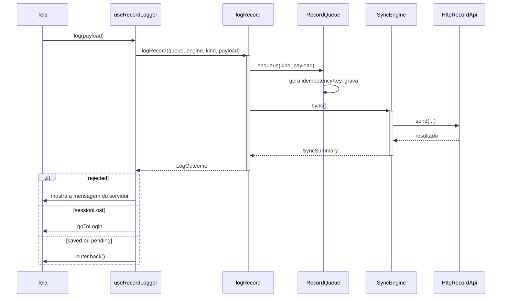
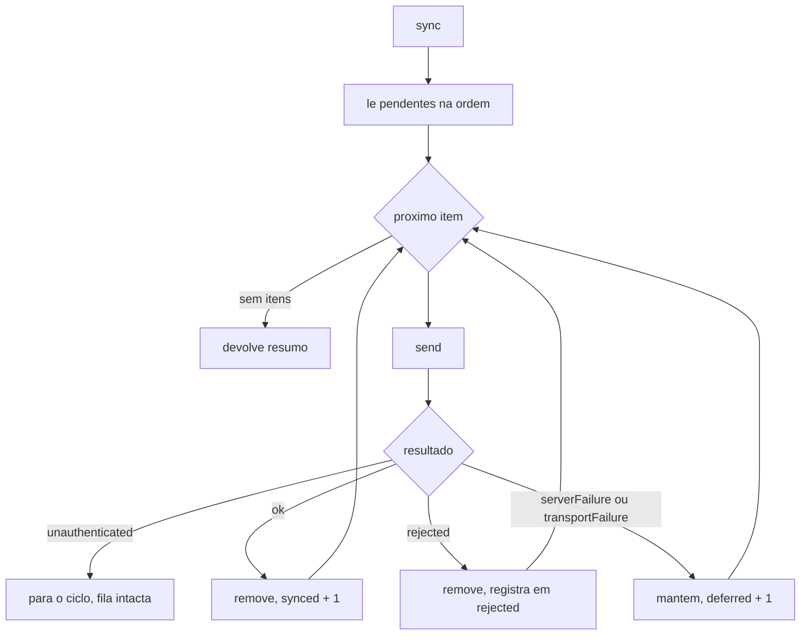

# RecordQueue - Fila Offline - Especificação Técnica

## Índice

- [1. Visão Geral Técnica](#1-visão-geral-técnica)
- [2. Configuração e Dependências](#2-configuração-e-dependências)
- [3. Detalhamento por Fluxo](#3-detalhamento-por-fluxo)
  - [3.1. Registrar: fila primeiro, rede depois](#31-registrar-fila-primeiro-rede-depois)
  - [3.2. Sincronização](#32-sincronização)
  - [3.3. Auto-sync na volta da conexão](#33-auto-sync-na-volta-da-conexão)
- [4. Observações Técnicas](#4-observações-técnicas)

## 1. Visão Geral Técnica

**Propósito**: permitir que o corredor registre treino, dor ou pedido de plano sem sinal e receba confirmação imediata; o envio é oportunista e seguro contra duplicata.
**Responsabilidades**:

- `RecordQueue`: guarda pendentes; gera a chave de idempotência **uma vez**, no `enqueue`.
- `SyncEngine`: envia um a um e decide o destino de cada item pelo resultado.
- `startAutoSync`: dispara a sincronização na reconexão.
- `logRecord` / `outcomeOf` / `useRecordLogger`: ligam as telas à fila.
- `AsyncStorageQueue`: persistência (`@steady/fila-de-registros`).
- `features/date.ts`: datas em calendário local, nunca UTC.

**Integrações**: AsyncStorage, NetInfo, `HttpRecordApi`.

## 2. Configuração e Dependências

**Tipos** (`sync/types.ts`):

- `RecordKind`: `running | strength | strengthWorkout | combinedWorkout | pain | plan`.
- `PendingRecord { idempotencyKey, kind, payload, queuedAt }`.
- `ENDPOINT_BY_KIND`: rota da API por tipo.
- `QueueStorage`: porta `read()/write()`.

**Resultados**:

- `ApiResponse`: `ok | rejected | serverFailure | transportFailure | unauthenticated`.
- `SyncSummary { synced, deferred, rejected[], unauthenticated }`.
- `LogOutcome`: `saved | pending | rejected | sessionLost`.

## 3. Detalhamento por Fluxo

### 3.1. Registrar: fila primeiro, rede depois

**C. `useRecordLogger(kind)`**

C.1. `log(payload)`

- Marca `saving`, limpa `problem`, chama `logRecord`, trata o desfecho e libera `saving` no `finally`.
- `saved` e `pending` são o mesmo desfecho para o corredor (o registro está guardado); a home mostra quantos faltam.

**G. `logRecord` / `outcomeOf`**

G.1. `outcomeOf(summary, kind)`

- `rejected` só considera itens **do mesmo `kind`** do registro que acabou de ser feito.
- Depois, `unauthenticated` vira `sessionLost`; `deferred > 0` vira `pending`; senão `saved`.

### 3.2. Sincronização

**E. `SyncEngine.sync()`**

E.1. Percorre `queue.pending()` em ordem, um item por vez.
E.2. `unauthenticated` interrompe o ciclo (insistir repetiria a mesma falha).
E.3. `ok` e `rejected` removem o item; só `rejected` entra no resumo.
E.4. Falhas transitórias mantêm o item.

**Q. `RecordQueue`**

Q.1. `enqueue`: lê tudo, grava `[...records, record]`.
Q.2. `remove(key)`: lê tudo, grava filtrado.
Q.3. `clear()`: só para o encerramento de sessão (ADR-005).
Q.4. `count()`: número que a home exibe.

### 3.3. Auto-sync na volta da conexão

- `startAutoSync(connectivity, engine)` guarda `online: boolean | 'unknown'`; o primeiro aviso de online dispara sync, pois pode haver pendente de sessão anterior.
- `netInfoConnectivity`: online quando `isConnected === true` e `isInternetReachable !== false` (`null` ainda tenta).
- Falha do sync é engolida: os itens ficam para a reconexão seguinte.
- Também roda uma vez na abertura (`_layout`), depois de `combinedWorkoutDrafts.recover()`.

## 4. Observações Técnicas

- **Performance**: envio estritamente sequencial; um item lento atrasa os seguintes.
- **Tratamento de Erros**: arquivo corrompido no AsyncStorage vira fila vazia, para o app não travar.
- **Integrações Críticas**: a chave de idempotência gerada no `enqueue` é o que torna o reenvio seguro (ADR-003).
- **Segurança**: o item da fila não guarda dono e o token só é anexado no envio; por isso a fila é descartada na saída (ADR-005).
- **Concorrência**: `enqueue` e `remove` fazem ler-modificar-gravar sem exclusão mútua; ver débitos.
