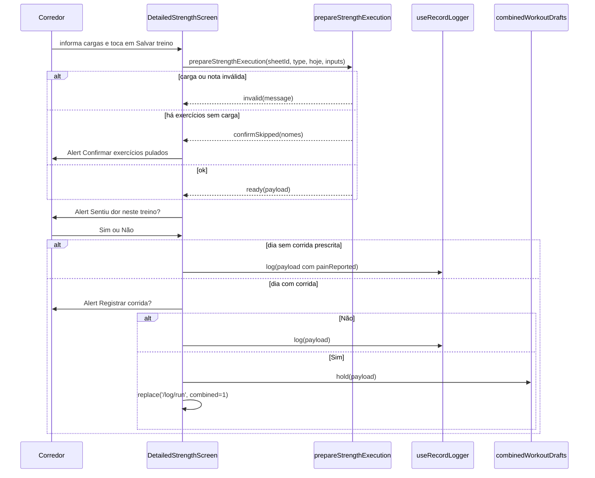

# RunnerSheet - Ficha - Especificação Técnica

## Índice

- [1. Visão Geral Técnica](#1-visão-geral-técnica)
- [2. Configuração e Dependências](#2-configuração-e-dependências)
- [3. Detalhamento por Fluxo](#3-detalhamento-por-fluxo)
  - [3.1. Escolher o treino realizado](#31-escolher-o-treino-realizado)
  - [3.2. Registrar a execução da ficha](#32-registrar-a-execução-da-ficha)
  - [3.3. Dia combinado: musculação e corrida](#33-dia-combinado-musculação-e-corrida)
  - [3.4. Ficha em cache e prescrição do dia](#34-ficha-em-cache-e-prescrição-do-dia)
  - [3.5. Apresentação da revisão](#35-apresentação-da-revisão)
- [4. Observações Técnicas](#4-observações-técnicas)

## 1. Visão Geral Técnica

**Propósito**: lado do corredor da ficha publicada pelo personal: escolher o treino, informar a carga real por exercício, registrar a execução (isolada ou combinada com a corrida) e ler a revisão.
**Responsabilidades**:

- `app/coaching/select.tsx`: "Qual treino você fez?" (Empurrada, Puxada, Inferiores, Corrida).
- `app/coaching/strength.tsx`: execução detalhada, exercício a exercício.
- `workoutExecution`: validação de carga e montagem do payload.
- `combinedWorkoutDrafts`: guarda a musculação enquanto a corrida é registrada (ADR-011).
- `dailyPrescription`: mapeia o dia da semana para treino e corrida da ficha.
- `TrainingSheetCache` e `AsyncStorageTrainingSheet`: ficha com cópia local.
- `workoutReviewView`, `WorkoutReviewCache`: apresentação e cache da última revisão.
**Integrações**: `GET /api/coaching/training-sheet/active`, fila (`strengthWorkout`, `combinedWorkout`), `GET /api/workout-reviews/*`.

## 2. Configuração e Dependências

**Telas**: `/coaching/select` ("Registrar Treino"), `/coaching/strength` ("Registrar ficha") com parâmetros `type`, `planDay`, `runPrescription`.

**Payloads** (`StrengthExecutionPayload`): `{ trainingSheetId, workoutType, date, painReported?, exercises[{ exerciseId, loadKg, note, skipped }] }`.
**Combinado**: `{ strength: StrengthExecutionPayload, running: RunningExecutionPayload }` com `kind` `combinedWorkout`.

**Tipos de ficha** (`types.ts`): `TrainingSheet { id, corredorId, createdAt, workouts[] }`; `WorkoutPrescription { type, exercises[], runDescriptions? }`; `ExercisePrescription { id, exerciseKey?, name, sets, repetitions, suggestedLoadKg, durationSeconds, observation }`; `RunPrescription { description, distanceKm?, durationMinutes?, perceivedEffort? }` com `NumericRange { min, max }`.

## 3. Detalhamento por Fluxo

### 3.1. Escolher o treino realizado

**C. `SelectWorkoutScreen`**

C.1. Carrega a ficha (`trainingSheetCache.load()`); `unauthenticated` leva ao login; falha mostra "Não foi possível carregar a ficha do personal."
C.2. `planDay` inválido vira 0; `dailyPrescription(sheet, dia)` fornece a descrição da corrida do dia.
C.3. Musculação -> `router.replace('/coaching/strength', { type, planDay, runPrescription })`. Corrida -> `/log/run` com a descrição como `prescription`. Sem corrida no dia, oferece Terça, Quinta e Sábado.

### 3.2. Registrar a execução da ficha

**C. Tela (`DetailedStrengthScreen`)**

C.1. Tipo de treino vem do parâmetro, restrito a `push|pull|lower` (padrão `push`).
C.2. Carrega a ficha e **pré-preenche a carga** com `suggestedLoadKg` (duas casas, vírgula); a observação do corredor começa vazia. Mostra a observação do personal e o tempo prescrito.
C.3. `stale` exibe "Você está usando a ficha salva offline.".

**V. `prepareStrengthExecution` / `validateLoad`**

V.1. Carga em branco é válida e vale `null`. Formato `-?\d+([.,]\d+)?`, no máximo 2 casas decimais, entre 0 e 999,99.
V.2. Observação com mais de 200 caracteres é recusada, com o nome do exercício.
V.3. **Carga `null` ou `0` significa exercício pulado** (`skipped: true`, `loadKg: null`); qualquer pulado exige confirmação explícita.

### 3.3. Dia combinado: musculação e corrida

- `hold` guarda a musculação no AsyncStorage (`@steady/rascunho-treino-combinado`) e a tela de corrida abre com `combined=1`.
- `completeWithRun`: junta o rascunho com a corrida em **um** item `combinedWorkout` (uma chave de idempotência, uma transação no servidor); o `painReported` combina as respostas com OU.
- `finishStrengthOnly`: enfileira o rascunho como `strengthWorkout` e o apaga; chamado se o corredor sai da corrida sem registrá-la, e na abertura do app (`recover`).
- `hasPending` e `clear` servem ao encerramento de sessão (ADR-005).

### 3.4. Ficha em cache e prescrição do dia

- `TrainingSheetCache.load()`: lê o cache, chama a API; `ok` regrava e devolve `stale: false`; `unauthenticated` repassa; falha com cache devolve `stale: true`; sem cache, `failure`.
- `dailyPrescription`: grade fixa no cliente: segunda e sexta Inferiores, terça e quarta Empurrada, quinta Puxada, sábado e domingo sem musculação; corrida terça, quinta e sábado (ADR-010).
- `runPrescriptionSummary`: texto curto dos números opcionais ("8 km · 45–50 min · esforço 6"); `null` quando não há números.

### 3.5. Apresentação da revisão

- `workoutReviewView` traduz a revisão do servidor para texto: título (conflito ou "diferente do planejado"), ação (Manter, Reduzir carga, Priorizar recuperação), até 6 linhas de comparação, explicação e coerência.
- Faz parsing tolerante de `comparisonJson` e `explanationJson` (várias chaves aceitas) e devolve vazio em JSON inválido.
- `WorkoutReviewCache`: último resultado remoto, com cópia local usada quando a leitura falha.

## 4. Observações Técnicas

- **Performance**: uma leitura da ficha por tela; revisão sob demanda.
- **Tratamento de Erros**: cache de ficha mostra aviso de offline; recusa do servidor aparece em "Não foi salvo" nas telas de registro.
- **Integrações Críticas**: `exerciseId` da ficha liga a execução à prescrição (ADR-009, ADR-019).
- **Segurança**: ficha e revisão em cache contêm dados da conta; são limpas na saída explícita e, para a ficha, no login (ver [AuthSession](../debts/AuthSession-Autenticacao-Debts.md)).
