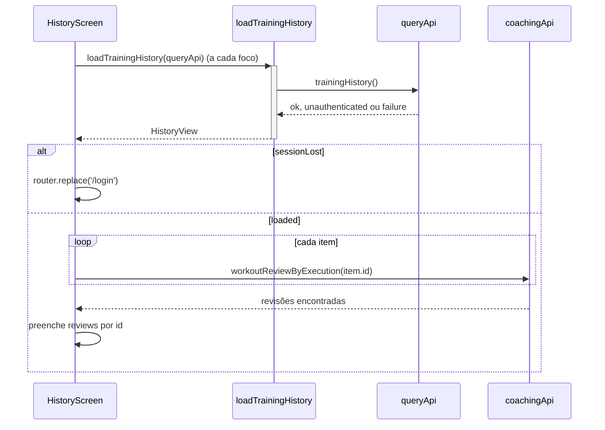

# TrainingHistory - Histórico - Especificação Técnica

## Índice

- [1. Visão Geral Técnica](#1-visão-geral-técnica)
- [2. Configuração e Dependências](#2-configuração-e-dependências)
- [3. Detalhamento por Fluxo](#3-detalhamento-por-fluxo)
  - [3.1. Carregar o histórico](#31-carregar-o-histórico)
  - [3.2. Montagem de cada linha](#32-montagem-de-cada-linha)
- [4. Observações Técnicas](#4-observações-técnicas)

## 1. Visão Geral Técnica

**Propósito**: tela em que o corredor confere que o registro feito na rua chegou ao servidor, junto com a revisão de aderência de cada treino.
**Responsabilidades**: `loadTrainingHistory` (estado da lista), `toItem`/`describe` (texto pronto), `labels.ts` (vocabulário), e a tela `HistoryScreen`, que também busca a revisão de cada item.
**Integrações**: `GET /api/training-sessions` e `GET /api/workout-reviews/by-execution/{id}`.

## 2. Configuração e Dependências

**Rota**: `/history` -> `app/history.tsx` (título "Histórico").

**Tipos**:

- `HistoryView`: `loaded { items }` | `empty` | `unavailable` | `sessionLost`.
- `HistoryItem { id, kicker, title, date }`.
- `TrainingSessionSummary` (de `api/queryApi`).

**Dependências**: `queryApi`, `coachingApi`, `workoutReviewView` (apresentação da revisão).

## 3. Detalhamento por Fluxo

### 3.1. Carregar o histórico

#### Detalhamento do Fluxo

**C. Tela (`HistoryScreen`)**

C.1. `useFocusEffect`

- Recarrega a cada vez que a tela ganha foco; flag `active` descarta resposta tardia.
- `sessionLost` nunca vira estado: leva ao login com `router.replace`.
- Para `loaded`, dispara uma busca de revisão **por item**, em paralelo; só itens com resposta `ok` entram no mapa.

C.2. Renderização

- Estados distintos: carregando, `empty` ("Nada registrado ainda"), `unavailable` ("Não foi possível carregar... nenhum registro foi perdido") e lista.
- Cada item mostra tipo, resumo, data e, se há revisão, `HistoryReview` (título, ação, explicação ou aviso de indisponibilidade, leitura confirmada ou não, coerência).

**L. Lógica (`loadTrainingHistory`)**

L.1. Traduz `QueryResult` em `HistoryView`: `unauthenticated` vira `sessionLost`; `failure` vira `unavailable` (distinto de `empty`); lista vazia vira `empty`.

### 3.2. Montagem de cada linha

**D. `describe(session)`**

D.1. Corrida: `"{km} km · {min} min"` com vírgula decimal e sem casa quando inteiro; sem distância, só a duração.
D.2. Musculação: partes não nulas unidas por " · ": treino da ficha (`Empurrada`, `Puxada`, `Inferiores`), grupo muscular, intensidade e duração. A execução da ficha não tem duração nem grupo; nada é inventado.

**F. `formatDate`**

F.1. Formata a partir das partes do ISO, sem `Date`, porque `new Date('2026-08-15')` é UTC e mostraria o dia 14 em fuso negativo.

## 4. Observações Técnicas

- **Performance**: uma requisição por item para buscar revisões (N+1), disparada a cada foco da tela.
- **Tratamento de Erros**: a falha da busca de uma revisão é ignorada; a linha aparece sem revisão.
- **Integrações Críticas**: `workoutType` vem minúsculo (`push`, `pull`, `lower`) do servidor e é mapeado em `WORKOUT_LABELS`; tipo desconhecido não aparece.
- **Segurança**: a lista é sempre do corredor autenticado; o filtro por `corredor_id` é do servidor.
