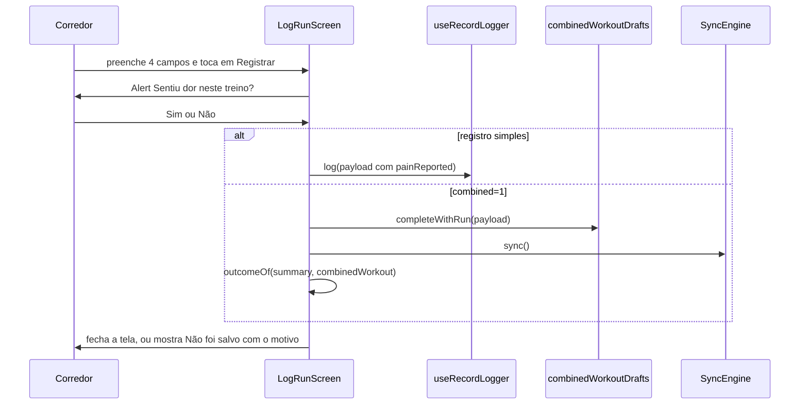

# TrainingLog - Registro - Especificação Técnica

## Índice

- [1. Visão Geral Técnica](#1-visão-geral-técnica)
- [2. Configuração e Dependências](#2-configuração-e-dependências)
- [3. Detalhamento por Fluxo](#3-detalhamento-por-fluxo)
  - [3.1. Registrar corrida](#31-registrar-corrida)
  - [3.2. Registrar musculação](#32-registrar-musculação)
  - [3.3. Registrar dor](#33-registrar-dor)
- [4. Observações Técnicas](#4-observações-técnicas)

## 1. Visão Geral Técnica

**Propósito**: telas de registro livre (sem ficha do personal) de corrida, musculação e dor.
**Responsabilidades**: coletar campos, pedir a resposta obrigatória sobre dor no encerramento, montar o `payload` e entregá-lo à fila via `useRecordLogger`. A validação de verdade é do domínio, no servidor.
**Integrações**: `useRecordLogger` (fila), `useWeekPlan` e `planDayFromParam` (contexto do plano), `combinedWorkoutDrafts` (registro combinado), `Field`/`Choice` do design system.

## 2. Configuração e Dependências

**Telas (rotas)**:

- `/log/run` -> `app/log/run.tsx`; parâmetros opcionais `planDay`, `prescription`, `combined`.
- `/log/strength` -> `app/log/strength.tsx`; parâmetro opcional `planDay`.
- `/log/pain` -> `app/log/pain.tsx`.

**Payloads enviados à fila** (`RecordKind` -> corpo):

| Tela | `kind` | Corpo |
| --- | --- | --- |
| Corrida | `running` | `{ date, distanceKm, durationMinutes, averagePaceMinPerKm, perceivedEffort, painReported }` |
| Corrida combinada | `combinedWorkout` (via rascunho) | corrida + musculação da ficha em um item |
| Musculação | `strength` | `{ date, muscleGroup, intensity, durationMinutes, painReported }` |
| Dor | `pain` | `{ date, region }` |

`date` é sempre `todayIso()` (calendário local).

## 3. Detalhamento por Fluxo

### 3.1. Registrar corrida

**C. Tela (`LogRunScreen`)**

C.1. Estado e contexto

- Quatro campos de texto (`distanceKm`, `durationMinutes`, `averagePace`, `perceivedEffort`); o botão só habilita com todos preenchidos.
- `planDay` vem de `planDayFromParam` e só exibe contexto ("Hoje no seu plano"); distância, ritmo e esforço são medidas do que aconteceu, nunca pré-preenchidas (regra 9).
- `params.prescription`, quando existe, mostra o texto da ficha do personal.

C.2. `submit()` e `save(painReported)`

- A resposta sobre dor é obrigatória para concluir (`Alert` com Não e Sim).
- `payload` troca vírgula por ponto em distância e ritmo e converte para `Number`.
- Fluxo simples: `log(payload)` ([RecordQueue](RecordQueue-FilaOffline-DevDocs.md#31-registrar-fila-primeiro-rede-depois)).
- Fluxo combinado (`combined=1`): `combinedWorkoutDrafts.completeWithRun` grava o item combinado atômico; `syncEngine.sync()`; `outcomeOf` define a navegação (`rejected` mostra a mensagem, `sessionLost` vai ao login, senão `router.back()`).

C.3. Efeito de desmontagem

- Se a tela sai no modo combinado sem concluir (`completed.current` falso), executa `combinedWorkoutDrafts.finishStrengthOnly()` e sincroniza: a musculação não se perde e segue isolada (ADR-011).

### 3.2. Registrar musculação

**C. Tela (`LogStrengthScreen`)**

C.1. Pré-seleção pelo plano

- Quando chega por `planDay`, um efeito preenche `muscleGroup` com `plannedMuscleGroup(planDay)` **somente se** o corredor ainda não escolheu.

C.2. Registro

- Habilita com grupo, intensidade e duração; mesma pergunta sobre dor; `log` com o `kind` `strength`.
- O texto de apoio explica que treino de perna pesado é o que a avaliação cruza com a corrida.

### 3.3. Registrar dor

**C. Tela (`LogPainScreen`)**

C.1. Região

- `Choice` com sete regiões e campo "Outra região"; o texto livre, se preenchido, tem precedência sobre a escolha.
- A dor é registrada **solta**, sem vínculo com sessão (decisão da STORY-003).
- Não pergunta nada adicional; `log({ date, region })`.

## 4. Observações Técnicas

- **Performance**: sem chamadas de rede na tela além do envio; `useWeekPlan` lê o plano do cache em segundo plano.
- **Tratamento de Erros**: `rejected` do servidor aparece em "Não foi salvo. {mensagem}"; falha de rede não é erro (vira pendente).
- **Integrações Críticas**: a resposta de dor no encerramento alimenta a política de segurança do servidor (ADR-014).
- **Segurança**: nenhuma validação de limites no cliente (decisão para não duplicar a fonte da verdade); `Number("abc")` vira `NaN`, serializado como `null`, e o servidor recusa.
